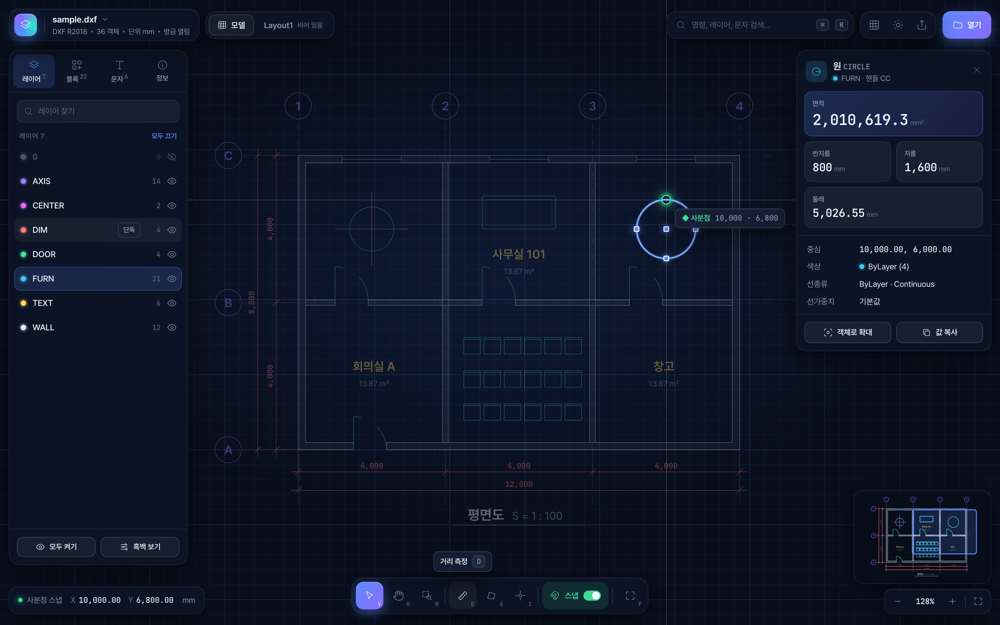
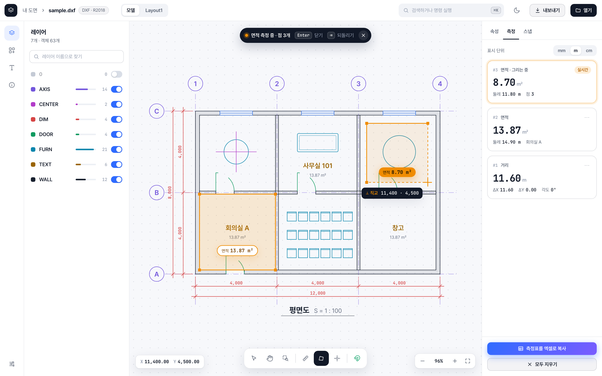
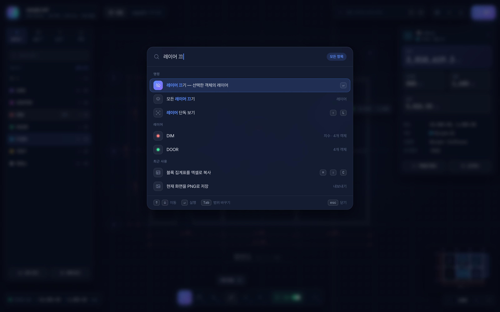

# 화면 디자인 개선 제안

현재 화면을 검토하고, 개선 방향을 보여 주는 목업 4장을 만들었습니다.
목업은 방향을 맞추기 위한 시안입니다. 앱 코드(`template.html`, `src/`)는 바꾸지 않았습니다.

## 목업 보기

- 이미지: [`images/`](images/)
- HTML: [`mockups/index.html`](mockups/index.html)을 브라우저로 열면 위쪽 탭(또는 숫자키 1~4)으로 4장을 넘겨 볼 수 있습니다.
  - 각 HTML은 CSS와 JS를 안에 담은 독립 파일이라 하나만 열어도 됩니다. `index.html`만 나머지 4개 파일을 불러옵니다.
  - 1번 화면에서 <kbd>⌘K</kbd> / <kbd>Ctrl+K</kbd>를 누르면 명령 팔레트가 열리고 닫힙니다. 그 밖의 버튼은 동작하지 않는 정적 목업입니다.
  - 도면은 실제 뷰어로 그린 것이 아니라, 같은 샘플 평면도를 SVG로 다시 그린 것입니다.
  - 글꼴(Pretendard, JetBrains Mono)은 인터넷에서 불러오므로 오프라인에서는 시스템 글꼴로 보입니다.

| | 화면 | 핵심 |
|---|---|---|
| 1 |  **블루프린트 다크 · 메인** | 도면이 화면 전체를 쓰고 도구는 반투명 플로팅 패널, 하단 도구 막대, 선택 객체 강조, 큰 숫자 속성 카드, 미니맵 |
| 2 |  **페이퍼 라이트 · 측정** | 아이콘 레일과 도크형 패널, 레이어 토글, 측정 중 안내 캡슐, 측정 결과 카드와 단위 전환 |
| 3 |  **시작 화면** | 로컬 처리 배지, 빛나는 드롭 영역, 최근 도면 썸네일 카드 |
| 4 |  **명령 팔레트(⌘K)** | 리본에 있던 기능을 검색 한 번으로 실행 |

## 현재 화면의 문제점

샘플 DXF(레이어 7개, 블록 22개, 치수, 한글 문자)를 크롬에서 열어 확인했습니다.

**레이아웃**
- 위쪽 리본이 약 100px를 차지합니다. 뷰어에서 주로 쓰는 기능(열기, 이동, 측정)에 비해 편집기 수준으로 무겁습니다.
- 좌우 패널(300px + 290px)이 늘 열려 있어서, 1512px 화면에서 도면 영역이 약 1050px뿐입니다. 아무것도 선택하지 않아도 "객체 속성" 패널이 빈 채로 자리를 차지합니다.
- 같은 버튼이 리본, 빠른 실행, 하단 상태바에 겹쳐 있습니다. "전체 보기"는 세 군데에 있습니다.
- 맨 아래 해시태그 줄(`#바이브코딩 #무료배포 …`)이 앱 화면보다 블로그 글처럼 보여서 완성도를 떨어뜨립니다.

**첫 화면**
- 빈 캔버스 위 카드 한 장에, 양옆 패널에는 "도면을 열면…" 안내 문구만 보여서 화면이 비어 보입니다.

**캔버스**
- 배경이 단색이고 그리드나 원점 표시가 없습니다.
- 전체 보기 여백이 좁아서 도면 하단 문자가 줌 버튼, 힌트 문구와 겹칩니다.
- 선택 강조(반투명 파란 굵은 선)가 다른 객체 위에서 잘 안 보이고, 측정 라벨도 작습니다.
- 줌 컨트롤은 +와 −뿐이고, 배율 표시는 상태바 구석에 떨어져 있습니다.

**시각 요소**
- 액센트 색(`#1f63c6`)이 무난하지만 개성이 없습니다. hover와 활성 상태가 같은 연파랑이라 계층감이 없습니다.
- 다크 모드에서 패널(`#1a1f26`)과 캔버스(`#1d232b`)의 명도가 거의 같아 경계가 흐립니다.
- 그림자, 블러, 전환 효과가 거의 없어서 화면이 평평합니다.

## 개선 방향

1. **캔버스 우선 구조.** 도면을 화면 전체로 쓰고 패널은 블러가 들어간 플로팅 카드로 띄웁니다. 속성 카드는 객체를 선택했을 때만 나옵니다.
2. **리본을 하단 도구 막대와 ⌘K 명령 팔레트로 대체.** 자주 쓰는 도구 7~8개만 남기고, 나머지 기능은 검색으로 실행합니다.
3. **캔버스 연출.** 배율에 따라 간격이 바뀌는 그리드, 커서 십자선과 스냅 말풍선, 선택 객체 글로우와 나머지 흐리게 처리, 치수선 스타일의 측정 라벨, 미니맵, 부드러운 줌 애니메이션.
4. **정보를 크게.** 길이, 면적, 좌표 같은 숫자를 고정폭 글꼴로 크게 보여 줍니다.
5. **타이포와 색.** 한글은 Pretendard, 숫자는 JetBrains Mono. 블루에서 바이올렛으로 넘어가는 그라데이션 액센트와 반투명 1px 테두리.
6. **첫 화면.** "100% 로컬 처리" 장점을 앞에 내세우고, 최근 연 도면 목록(localStorage)을 보여 줍니다.

다크(1)와 라이트(2)는 테마만 다른 게 아니라 레이아웃 구조(플로팅형, 도크형)도 다릅니다. 테마와 구조는 따로 골라 섞을 수 있습니다.

## 적용 순서 제안

1. **빠른 정리:** 해시태그 줄 제거, 중복 버튼 정리, 빈 속성 패널 자동 숨김, 전체 보기 여백 확대
2. **캔버스 연출:** 그리드, 미니맵, 선택·측정 스타일
3. **구조 개편:** 플로팅 패널, 하단 도구 막대, 명령 팔레트, 새 테마

## 참고

- 목업의 최근 도면 항목, "v2.0" 표기, "예제 도면 열기" 버튼, 측정 단위 전환은 연출용입니다. 지금 앱에는 없는 기능입니다.
- 1~3단계를 적용하려면 `template.html`의 구조와 `src/app.js`의 DOM 선택자를 함께 바꿔야 합니다.
- 리뷰 중에 본 것: ezdxf로 만든 샘플 DXF에서 치수선은 그려졌지만 치수 숫자가 표시되지 않았습니다. 실제 AutoCAD 도면에서도 그런지는 따로 확인이 필요합니다.
